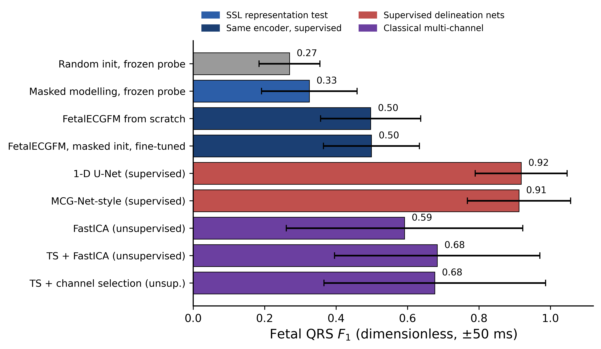
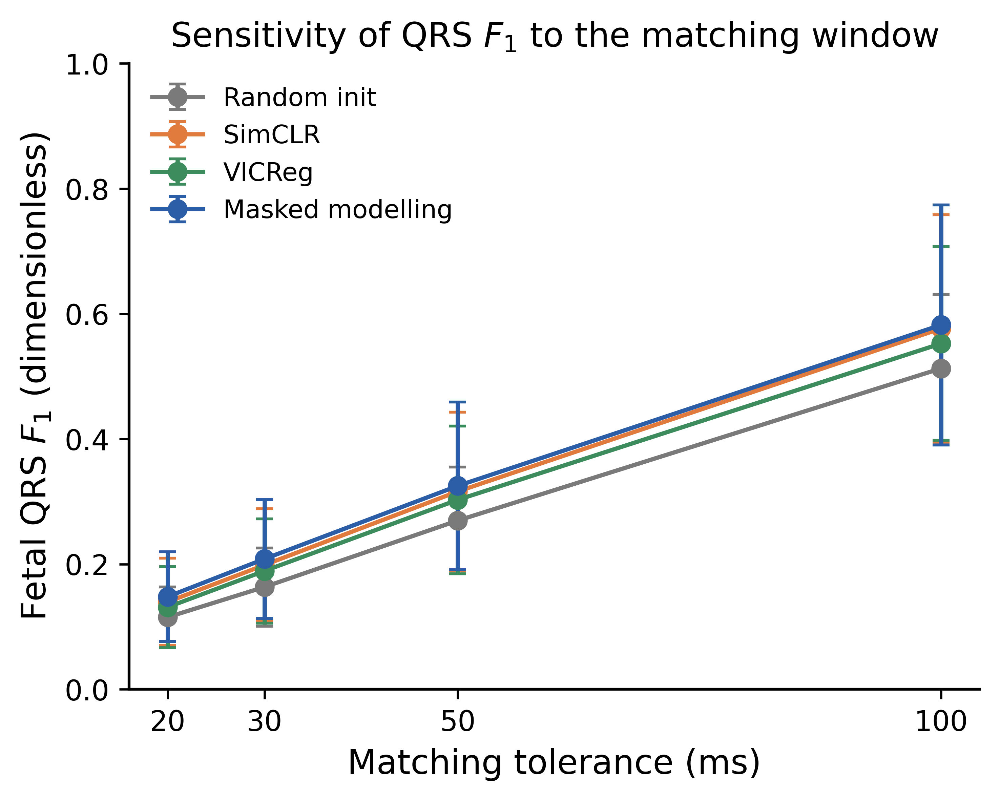
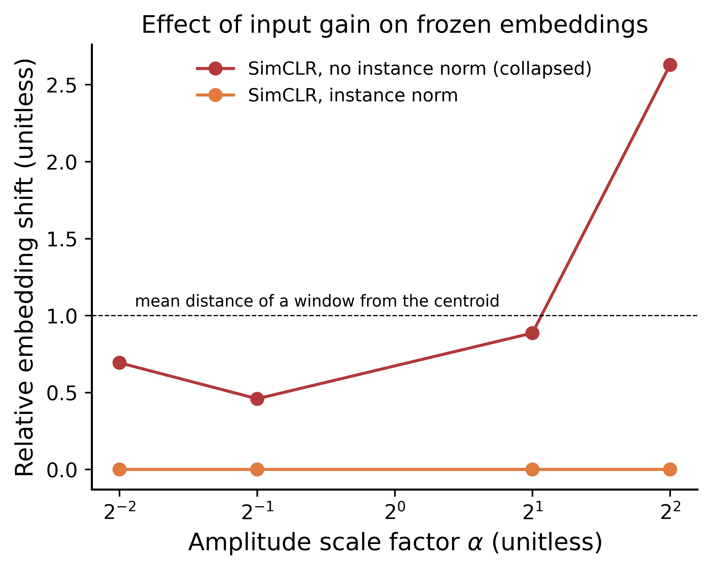
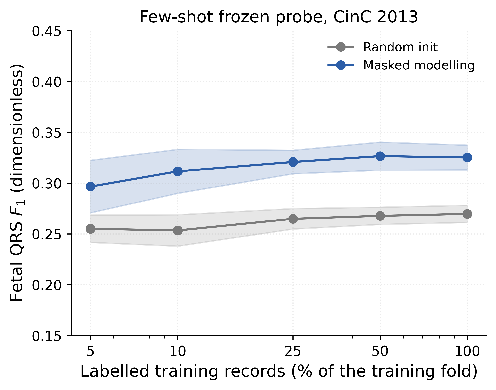

# Self-Supervised Pre-Training for Non-Invasive Fetal ECG

Reproducible code, measured result files, and publication figures for:

> **Self-Supervised Pre-Training for Non-Invasive Fetal
> Electrocardiography from Limited Open-Access Data: A Cross-Dataset
> QRS-Transfer Benchmark**

The study compares SimCLR, VICReg, and masked signal modelling on one encoder.
Pre-training uses 60 NInFEA records and eight NI-FECG files; all 75 annotated
PhysioNet/CinC 2013 set-a records are held out for record-grouped evaluation.
All data are open access. Random seeds, record lists, configurations, per-record
scores, revision analyses, and 600 dpi figures are included.

## Main findings

- All three self-supervised objectives beat random initialisation with a frozen
  linear probe at the prespecified ±50 ms matching tolerance.
- Masked modelling reaches mean F1 **0.325** versus **0.270** for random
  initialisation: ΔF1 **+0.055**, paired Cohen's dz **0.75**, bootstrap 95% CI
  **[0.039, 0.072]**, two-sided Wilcoxon **p = 1.36e-7**.
- Its numeric edge over SimCLR is not significant: ΔF1 **+0.009**,
  **p = 0.142**. Across three matched-budget seeds the two objectives remain
  tied.
- Without instance normalisation, SimCLR falls below random, whereas masked
  modelling does not collapse. Three no-normalisation masked runs give
  F1 **0.359 ± 0.005**.
- The representation result is not a detector-performance claim. On the same
  75 records, a supervised MCG-Net-style model and 1-D U-Net reach mean F1
  **0.912** and **0.918**, respectively; FastICA and template-subtraction
  baselines reach **0.592–0.683**.
- Full end-to-end fine-tuning erases the pre-training gap. Linear CKA shows the
  two initialisations converging to similar representations.
- Embeddings do not encode gestational age and remain acquisition-dataset
  separable. Transfer to the five-record ADfECGDB device does not beat random.



## Evaluation protocol

- **Pre-training:** NInFEA (60 records, 39 subjects) plus eight NI-FECG files.
- **Held-out benchmark:** all 75 CinC 2013 set-a records with `.fqrs`
  annotations; no quality screening.
- **Cross-validation:** record-grouped five-fold CV; each CinC record is a
  distinct case.
- **Detection:** frozen encoder plus linear token classifier; threshold selected
  on each training fold; 300 ms refractory period.
- **Primary score:** per-record fetal-QRS F1 with ±50 ms matching.
- **Statistics:** two-sided paired Wilcoxon tests, paired Cohen's dz, and
  record-level percentile bootstrap confidence intervals.



## Reproduce

Python 3.9 or newer is recommended.

```bash
python3 -m venv .venv
source .venv/bin/activate
pip install -r requirements.txt

# Original pre-training, frozen probes, fine-tuning, structure tests, figures
bash reproduce_fm.sh

# Reviewer-requested analyses using the released checkpoints
DEVICE=mps bash run_revision_all.sh
```

Use `DEVICE=cuda` on CUDA machines or `DEVICE=cpu` when no accelerator is
available. The full retraining sequence is intentionally expensive. Individual
revision stages can be run separately:

```bash
bash train_revision.sh          # matched budget, seeds, masks, physics, CNN-only
bash train_revision_seeds.sh    # extra SimCLR seed
bash train_revision2.sh         # no-normalisation masked run
bash train_revision3.sh         # two more no-normalisation masked seeds
python3 src/score_round2.py      # score second-round checkpoints
python3 src/direct_baselines.py # FastICA, TS+FastICA, MCG-Net-style, U-Net
python3 src/revision_round2.py  # signal quality, rhythm, noise and CKA
python3 src/make_revision_figures.py
```

The failed larger-batch VICReg attempts and the unfinished CinC set-b scale
experiment are not reported as scientific results.

## Results and figures

- `results/benchmark/`: original per-record benchmark scores and summaries.
- `results/revision/`: reviewer-requested JSON results, including pairwise
  statistics, tolerance sensitivity, repeated few-shot draws, low-label
  fine-tuning, direct baselines, signal-quality/rhythm analyses, CKA, and
  no-normalisation runs.
- `results/real_figs/`: publication figures at 600 dpi.

Important machine-readable outputs:

- `results/revision/pairwise_stats.json`
- `results/revision/qrs_tolerances.json`
- `results/revision/direct_baselines.json`
- `results/revision/round2_analyses.json`
- `results/revision/round2_ckpts.json`
- `results/revision/lowlabel_finetune.json`
- `results/revision/audit_splits_maternal.json`





## Code map

- `src/model.py`: multi-scale CNN + Transformer encoder, projection head,
  masked-signal decoder, SimCLR and VICReg objectives.
- `src/train_foundation.py`: all pre-training modes and component ablations.
- `src/eval_qrs.py`: frozen QRS probe, record-grouped folds and tolerance sweep.
- `src/eval_finetune.py`: end-to-end and low-label fine-tuning.
- `src/eval_structure.py`: effective rank, gestational-age and hardware probes.
- `src/direct_baselines.py`: FastICA, template subtraction, MCG-Net-style and
  1-D U-Net baselines.
- `src/revision_experiments.py`: paired effects, fold reassignment, few-shot
  repeats and checkpoint scoring.
- `src/revision_audit.py`: split checks and maternal-QRS false-positive overlap.
- `src/revision_round2.py`: amplitude/rhythm strata, controlled noise and CKA.
- `src/amplitude_causal.py`: controlled input-gain perturbation.
- `src/make_revision_figures.py`: 600 dpi revised figures.

## Data

- [NInFEA v1.0.0](https://doi.org/10.13026/c4n5-3b04)
- [Non-Invasive Fetal ECG Database v1.0.0](https://doi.org/10.13026/C2X30H)
- [PhysioNet/CinC Challenge 2013](https://physionet.org/content/challenge-2013/1.0.0/)
- [ADfECGDB](https://physionet.org/content/adfecgdb/1.0.0/)

Raw data, preprocessing caches, and model checkpoints are excluded from Git
because they are large and reproducible. PhysioNet datasets retain their own
licenses.

## Prior gestational-age benchmark

The repository also retains the earlier transparent classical-extraction and
gestational-age pipeline. Run `bash reproduce.sh`; its modules are documented
in `src/eval_extraction.py`, `src/build_ga_model.py`,
`src/robust_ga_analysis.py`, and `src/leakage_diagnostic.py`.

## License

MIT (see `LICENSE`).
